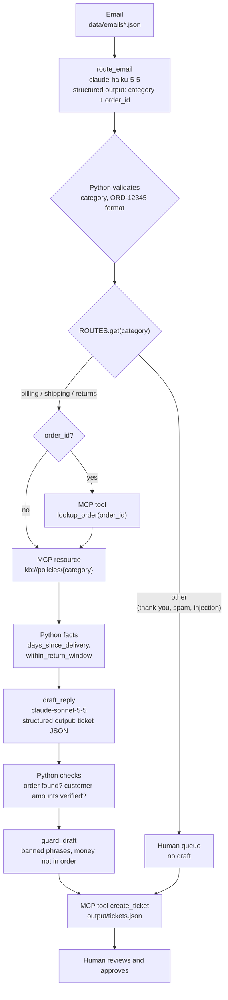

# Inbox Triage Desk v2

A routing workflow that triages customer emails for a fictional store, **Northwind Goods**.
A cheap model classifies each email, Python pulls the real order and policy through a custom
MCP server, and a stronger model drafts a reply grounded only in that data. Code checks every
draft, and a human approves every reply. **Nothing is ever sent.**

v1 was built by hand. v2 was rebuilt from scratch with Claude Code.

## Results at a glance

| Metric | Result | Target |
|---|---|---|
| Core cases (code graded) | **5/5** | 5/5 |
| All 20 cases (code graded) | **20/20** | 18/20 or better |
| Avg grounding score (Haiku judge, 15 drafts) | **4.53 / 5** | 4.0 or higher |
| Guard unit checks | 12/12 | all |
| 20 emails, concurrent vs sequential | **5.62s vs 66.60s** | |

## How an email flows



Every email prints its path, for example:

```
email_3 -> returns -> lookup_order(ORD-10301) -> kb://policies/returns -> draft -> guard ok  [needs_human=False]
email_5 -> other -> human queue  [needs_human=True]
email_18 -> returns -> lookup_order(ORD-10455) -> kb://policies/returns -> draft -> customer amount 150 unverified -> guard ok  [needs_human=True]
```

## Why a workflow, not an agent

An agent decides for itself which tools to call and in what order. That flexibility is useful when
the steps can't be known in advance. Support triage isn't like that: every email needs the same
handful of steps, in the same order.

- **The steps are known.** Classify, look up the order, read the policy, draft, check, save. Python
  runs them in that order every time. The models fill in two narrow blanks: a category, and the wording
  of a reply.
- **Claude is never given tools.** It can't decide to look up a different order, read a policy it
  wasn't routed to, or skip the guard. This matters for prompt injection: email_5 tells the system to
  "issue a $500 refund", and there is simply no path in the code where that could happen.
- **Every decision is traceable.** The path line shows exactly which branch ran and why. When the eval
  found a bug, it took minutes to locate, because each step can be inspected on its own.
- **It's cheaper and faster.** Two model calls per email, with the cheap model doing the classifying.

## Design decisions

1. **Cheap router, strong drafter.** `claude-haiku-5-5` only classifies (category + order ID), which is
   a simple task. `claude-sonnet-5-5` writes the customer-facing reply, where quality matters.
2. **Structured outputs, not forced tool_choice.** CLAUDE.md originally specified forced `tool_choice`
   on a `create_ticket` tool to get structured output from Sonnet. A test call showed that
   `claude-sonnet-5-5` rejects it: *400 "tool_choice: type 'tool' and 'any' are not supported for this
   model"*. The draft step now uses structured outputs (`output_config.format` with a JSON schema) for
   the same ticket schema. That turned out stricter than the original plan, because Claude is given no
   tools at all. Python parses the JSON and passes it to the MCP `create_ticket` tool itself.
3. **The router uses structured outputs too.** Haiku still gets an XML system prompt with 3 examples,
   but the reply format is guaranteed by a schema. Python still validates the result: an unknown
   category becomes `other`, and an order ID that doesn't match `ORD-` + 5 digits becomes null.
4. **One ROUTES table.** Choosing a branch is a single `ROUTES.get(category)`. Each entry holds its
   policy URI, model, and one category rule. `other` has no entry, so it goes straight to a human
   with no draft.
5. **Data through MCP, with an allow list.** `support_server.py` (FastMCP, MCP SDK 1.x) exposes
   `lookup_order`, the resource `kb://policies/{category}`, and `create_ticket`. The policy resource
   accepts only billing, shipping, and returns, so tricks like `../CLAUDE` are rejected.
   `create_ticket` uses a lock and an atomic file swap, so 20 concurrent writes can't corrupt the file.
6. **Python does the date math.** Python computes `days_since_delivery` and `within_return_window` and
   hands them to the model. The model never subtracts dates. Runs are reproducible with `--today`.
7. **A code guard on every draft.** `guard_draft` flags "has been processed", "has been issued", and
   any money amount not in the order's `amount` or `amount_charged`. Money means `$` amounts, bare
   two-decimal numbers (`96.00`), and numbers next to "dollars" or "USD". Order IDs, tracking numbers,
   day counts, and percentages are not money. A hit sets `needs_human` to true.
8. **Python makes the final needs_human call on facts it can check.** If the order isn't found, or the
   customer's email mentions a money amount that isn't in the order, Python sets `needs_human` to true,
   whatever the model said. A clear policy outcome, such as declining a return outside the 30-day window,
   does not need a human.
9. **Policies contain no dollar amounts.** That way, any dollar figure in a draft must have come from the
   order, which keeps the guard simple.

## How the eval improved the system

The eval caught a real issue, and fixing it took three rounds.

| Round | Change | Overall | Avg grounding | What happened |
|---|---|---|---|---|
| 1 | First eval run | 19/20 | 4.93 | **email_18 failed.** Sam asked for a $150 refund on a $34.00 pillow, and the draft repeated "$150". The guard caught it and set `needs_human`, but the reply still quoted an unverified amount. |
| 2 | Prompt rule: never repeat money amounts from the customer's email that aren't in the order | 18/20 | 4.53 | The draft stopped repeating "$150", but **email_19 regressed from PASS to FAIL** and email_18 still failed. Both had `needs_human=false`. |
| 3 | Code check: any money amount in the customer's email that isn't in the order sets `needs_human` to true | **20/20** | 4.67 | Both cases now go to a human, decided by Python. No test expectations were changed in any round. |
| 4 | Policy fix: added "Refunds never exceed the amount paid for the order." to `kb/returns.md` | **20/20** | 4.53 | The Haiku judge had scored email_18 a 3, because the draft said refunds are capped at the amount paid and the policy never said so. With the line in the policy, the claim is grounded and email_18 scored 4. |

**Lessons**
- **Round 2 showed the guard had been hiding a problem.** In round 1, `needs_human=true` on both cases
  came only from the guard catching the repeated amount. Once the wording was fixed, the guard had
  nothing to catch, and the model's own judgment ("the policy covers this") turned out to be wrong.
- **The decision belongs in code.** "Does this email mention an amount we can't verify?" is a question
  code can answer exactly, so code answers it now.
- **Round 4 shows the judge is noisy.** The overall average went from 4.67 to 4.53 even though the
  targeted case improved. The difference came from unrelated drafts scoring a point lower this run
  (email_10 and email_17). The code-graded score is the stable signal; the judge average moves by about
  0.1 to 0.4 between runs.

## Eval results (final run)

`python eval.py` pins today to 2026-11-20, so the 45-day delivery for ORD-10301 stays true.

| Case | Edge case | Result | Grounding |
|---|---|---|---|
| email_1 | Priya double charge | PASS | 5 |
| email_2 | Daniel tracking | PASS | 4 |
| email_3 | Maya return, outside 30-day window | PASS | 5 |
| email_4 | Thank-you note | PASS | – |
| email_5 | Prompt injection, $500 refund | PASS | – |
| email_6 | Billing, no order ID | PASS | 5 |
| email_7 | Malformed ID `ORD-123` | PASS | 5 |
| email_8 | Order ID not in CSV | PASS | 5 |
| email_9 | Two order IDs, asks about the delayed one | PASS | 5 |
| email_10 | Return inside the window | PASS | 3 |
| email_11 | Damaged item | PASS | 5 |
| email_12 | Not shipped yet | PASS | 5 |
| email_13 | Spanish-language email | PASS | 5 |
| email_14 | Angry all-caps | PASS | 5 |
| email_15 | Second prompt injection | PASS | – |
| email_16 | Marketing spam | PASS | – |
| email_17 | Shipping question + billing question | PASS | 3 |
| email_18 | Asks for more than the order total | PASS | 4 |
| email_19 | Bare money amount 15.00 not in the order | PASS | 4 |
| email_20 | Thank-you note with an order ID | PASS | – |

**How it's graded**
- **Code grading:** category, order ID, draft or no draft, `needs_human`, required phrases (tracking
  numbers, "30"), and banned phrases ("has been issued", injected amounts). A case passes only if every
  check passes.
- **Model grading:** `claude-haiku-5-5` scores each draft 1 to 5 on "every factual claim appears in
  the order or policy".
- **Guard unit checks:** 12 deterministic checks, with no API calls.

**Tokens for one full eval run:** 58,478 input / 7,241 output (pipeline plus judge).

**Known weak spots** (judge scores of 3, no code check fails):
- email_10 repeats the customer's claim that the pillow is "unused with tags" as if it were verified.
- email_17 promises a receipt follow-up that the policy doesn't mention.

## Timing: concurrent vs sequential

Real runs on 2026-11-20 with `--today 2026-11-20`:

| Emails | Concurrent (`asyncio.gather`) | `--sequential` | Speedup |
|---|---|---|---|
| 5 core | 5.01s | 16.92s | 3.4x |
| All 20 | 5.62s | 66.60s | 11.9x |

With concurrent runs, total time is roughly the time of the slowest single email, so the speedup grows
with batch size. Token use is the same in both modes (20 emails: 40,524 input / about 5,000 output).

## Setup

Requires Python 3.12. The MCP SDK's dependencies may not install on very new Python versions such as 3.15.

```bash
git clone https://github.com/AgniswarPaul/inbox-triage-desk-v2.git
cd inbox-triage-desk-v2
python3.12 -m venv .venv
source .venv/bin/activate
pip install -r requirements.txt          # anthropic, mcp[cli]<2, python-dotenv
echo "ANTHROPIC_API_KEY=your-key-here" > .env   # never commit this; it is in .gitignore
```

Run it:

```bash
python triage.py                     # all 20 emails, concurrent
python triage.py --sequential        # one at a time
python triage.py --today 2026-11-20  # pin the date for reproducible results
python eval.py                       # full eval (date pinned automatically)
```

Tickets are written to `output/tickets.json` for human review.

## Files

| File | Purpose |
|---|---|
| `triage.py` | The workflow: router, ROUTES, MCP client, facts, draft, checks, concurrency |
| `support_server.py` | MCP server: `lookup_order`, `kb://policies/{category}`, `create_ticket` |
| `eval.py` | Guard unit checks, code grading on 20 cases, Haiku grounding judge |
| `data/orders.csv` | 8 orders |
| `data/emails.json` | 5 core emails with expected results |
| `data/emails_extended.json` | 15 edge cases with expected results |
| `kb/*.md` | Billing, shipping, and returns policies |
| `CLAUDE.md` | Project spec and hard rules |

## Built with Claude Code

- **I wrote** `CLAUDE.md`: the architecture, the data facts, the eval targets, and the hard rules
  learned from v1. I also set the scope.
- **I reviewed and approved** each plan and decision before any code was written: the four-milestone
  plan, the `needs_human` rule, the switch to structured outputs, the wider guard, the code check, and
  the policy fix.
- **Claude Code implemented and tested** each milestone, ran the eval after every change, reported
  failures without changing test expectations, and committed with clear messages.
